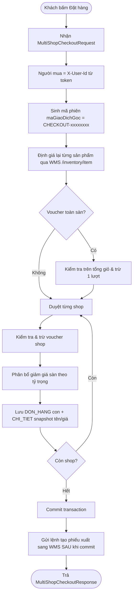
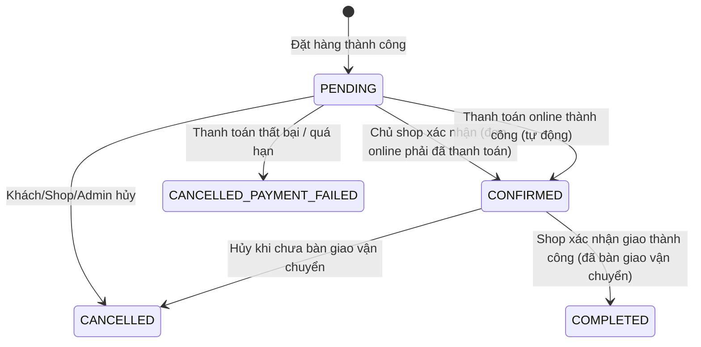

# TÀI LIỆU TOÀN CẢNH LOGIC HỆ THỐNG ĐỒ ÁN 3
## HỆ THỐNG QUẢN TRỊ KHO VẬN 2 TẦNG KẾT HỢP SÀN THƯƠNG MẠI ĐIỆN TỬ TẬP TRUNG (CTUT GEAR B2B2C)

> **Mã đề tài:** DA-TMDT-04  
> **Tên đề tài:** Xây dựng hệ thống WMS và E-commerce (WMS & Multi-Store E-commerce Marketplace)  
> **Mô hình kiến trúc:** Microservices (Spring Boot 4.1 / Spring Cloud Gateway / Netflix Eureka) + 3 Web Frontend (React + Vite)  
> **Cơ chế lưu trữ:** Database-per-service (5 cơ sở dữ liệu PostgreSQL độc lập)  
> **Cổng truy cập tập trung:** API Gateway `http://localhost:8080`  
> **Ngày cập nhật:** 27/11/2026 — đã đối chiếu với mã nguồn

---

## MỤC LỤC
1. [Tổng Quan Đề Tài & Mô Hình Nghiệp Vụ B2B2C](#1-tổng-quan-đề-tài--mô-hình-nghiệp-vụ-b2b2c)
2. [Kiến Trúc Tổng Thể Hệ Thống](#2-kiến-trúc-tổng-thể-hệ-thống)
3. [Phân Quyền RBAC & Cơ Chế Xác Thực](#3-phân-quyền-rbac--cơ-chế-xác-thực)
4. [Kho Vận 2 Tầng & Hợp Đồng Cung Ứng 7 Bước](#4-kho-vận-2-tầng--hợp-đồng-cung-ứng-7-bước)
5. [Quản Trị Gian Hàng & Đăng Bán Lên Sàn](#5-quản-trị-gian-hàng--đăng-bán-lên-sàn)
6. [Mua Sắm Khách Hàng & Voucher 2 Tầng](#6-mua-sắm-khách-hàng--voucher-2-tầng)
7. [Thuật Toán Tách Đơn Đa Gian Hàng](#7-thuật-toán-tách-đơn-đa-gian-hàng)
8. [Vận Hành Đơn Hàng & Giao Vận](#8-vận-hành-đơn-hàng--giao-vận)
9. [Thanh Toán & Cơ Chế Rollback Tự Động](#9-thanh-toán--cơ-chế-rollback-tự-động)
10. [Tương Tác: Bình Luận & Đánh Giá](#10-tương-tác-bình-luận--đánh-giá)
11. [Nghiệp Vụ Kho: Phiếu Nhập, Phiếu Xuất & Thẻ Kho](#11-nghiệp-vụ-kho-phiếu-nhập-phiếu-xuất--thẻ-kho)
12. [Báo Cáo Tài Chính](#12-báo-cáo-tài-chính)
13. [Danh Mục Endpoint API](#13-danh-mục-endpoint-api)
14. [Cấu Hình & Biến Môi Trường](#14-cấu-hình--biến-môi-trường)
15. [Kịch Bản Kiểm Thử & Tài Khoản Mẫu](#15-kịch-bản-kiểm-thử--tài-khoản-mẫu)
16. [Giới Hạn Hiện Tại & Hướng Mở Rộng](#16-giới-hạn-hiện-tại--hướng-mở-rộng)

---

## 1. TỔNG QUAN ĐỀ TÀI & MÔ HÌNH NGHIỆP VỤ B2B2C

### 1.1. Bài toán
- **Khó khăn của mô hình cũ:** website bán hàng truyền thống gộp chung kho và bán lẻ, hoặc mỗi cửa hàng một website riêng khiến khách phải có nhiều tài khoản, giỏ hàng phân mảnh, tồn kho không được kiểm soát dẫn tới bán vượt tồn (overselling).
- **Giải pháp:** mô hình chuỗi cung ứng **B2B2C** gồm **Kho Vận 2 Tầng (Two-Tier WMS)** và **Sàn TMĐT tập trung đa gian hàng**.

```
                      ┌──────────────────────────────────────┐
                      │        NHÀ CUNG CẤP GỐC (B2B)        │
                      └──────────────────┬───────────────────┘
                                         │ Phiếu nhập NCC (duyệt -> nhập kho thực tế)
                                         ▼
                      ┌──────────────────────────────────────┐
                      │   TẦNG 1: KHO TỔNG (loai_hinh=KHO_TONG)│
                      │   Thủ kho & Nhân viên kho vận hành   │
                      └──────────────────┬───────────────────┘
                                         │ Hợp đồng cung ứng điện tử 7 bước
             ┌───────────────────────────┴───────────────────────────┐
             ▼                                                       ▼
┌──────────────────────────┐                           ┌──────────────────────────┐
│ TẦNG 2: KHO CỬA HÀNG A   │                           │ TẦNG 2: KHO CỬA HÀNG B   │
│ (loai_hinh=KHO_CUA_HANG) │                           │ (loai_hinh=KHO_CUA_HANG) │
│ • Định giá bán lẻ        │                           │ • Định giá bán lẻ        │
│ • Bật/tắt đăng bán       │                           │ • Bật/tắt đăng bán       │
│ • Voucher riêng của Shop │                           │ • Voucher riêng của Shop │
└────────────┬─────────────┘                           └────────────┬─────────────┘
             └───────────────────────────┬───────────────────────────┘
                                         ▼
                      ┌──────────────────────────────────────┐
                      │  TẦNG 3: SÀN TMĐT TẬP TRUNG (B2C)     │
                      │  • 1 website, 1 tài khoản             │
                      │  • Giỏ hàng đa shop, tách đơn tự động │
                      │  • Voucher sàn + voucher shop         │
                      └──────────────────┬───────────────────┘
                                         ▼
                                   KHÁCH HÀNG
```

### 1.2. Ba trụ cột vận hành
1. **Kho Tổng (Tầng 1):** kho có `loai_hinh = KHO_TONG` trong bảng `kho_va_cua_hang`, do Thủ kho (`WAREHOUSE_MANAGER`/`THUKHO`) và Nhân viên kho (`WAREHOUSE_STAFF`/`NVKHO`) vận hành. Quản lý danh mục hàng hóa chuẩn (SKU), nhà cung cấp, nhập hàng từ NCC và xuất cung ứng cho các cửa hàng.
2. **Kho Cửa Hàng (Tầng 2):** mỗi Chủ cửa hàng (`STORE_OWNER`) sở hữu 1 kho riêng (`loai_hinh = KHO_CUA_HANG`, `quan_ly_id` = id người dùng). Hàng hóa mới vào kho shop chỉ thông qua **Hợp đồng cung ứng B2B** với Kho Tổng (endpoint `POST /inventory/add` chỉ dùng điều chỉnh tăng kiểm kê thừa hoặc hoàn trả nguyên vẹn cho mặt hàng đã có). Chủ shop tự định giá, bật/tắt đăng bán, phát hành voucher riêng.
3. **Sàn TMĐT (Tầng 3):** mọi gian hàng cùng bán trên 1 website. Khách hàng gom hàng nhiều shop vào 1 giỏ, thanh toán 1 lần; hệ thống tự **tách đơn** về từng shop.

---

## 2. KIẾN TRÚC TỔNG THỂ HỆ THỐNG

```
 ┌───────────────────────────────────────────────────────────────────────────────────────┐
 │                                TẦNG GIAO DIỆN (FRONTEND)                              │
 ├──────────────────────────────┬──────────────────────────────┬─────────────────────────┤
 │ ecommerce-frontend  :5173    │ admin-frontend  :5174        │ wms-frontend  :5175     │
 │ • Sàn mua sắm, giỏ, checkout │ • Quản lý người dùng & khóa  │ • Tồn kho, phiếu nhập/  │
 │ • Kênh Người Bán (/seller)   │ • Duyệt hợp đồng cung ứng    │   xuất, thẻ kho, HĐ B2B │
 │ • Hợp đồng cung ứng (shop)   │ • Tài chính B2B & GMV Shop   │ • Thủ kho duyệt/NV xuất │
 └──────────────────────────────┴──────────────┬───────────────┴─────────────────────────┘
                                               │ HTTP REST + JWT Bearer
                                               ▼
 ┌───────────────────────────────────────────────────────────────────────────────────────┐
 │ API GATEWAY :8080 (Spring Cloud Gateway)                                              │
 │ • Cửa ngõ duy nhất, CORS toàn cục                                                     │
 │ • Xác thực JWT, phân quyền RBAC theo danh sách endpoint (mặc định từ chối)            │
 │ • Xóa header định danh do client tự gửi, gắn lại: X-User-Account, X-User-Role,        │
 │   X-User-Id, X-Internal-Secret                                                        │
 │ • Chặn đường dẫn bất thường (//, .., %2e, %2f, ;)                                     │
 ├───────────────────────────────────────────────────────────────────────────────────────┤
 │ DISCOVERY SERVER :8761 (Netflix Eureka) — đăng ký & định tuyến lb://<service>          │
 └──────────────────────────────────────────────┬────────────────────────────────────────┘
                                                ▼
 ┌──────────────────────────┬──────────────────────────┬─────────────────────────────────┐
 │ identity-service :8084   │ wms-core-service :8081   │ order-service :8082             │
 │ • Đăng ký/đăng nhập, JWT │ • Danh mục, sản phẩm     │ • Đặt hàng, tách đơn đa shop    │
 │ • Vai trò, khóa tài khoản│ • Kho tổng & kho shop    │ • Voucher 2 tầng                │
 │ • Nâng cấp lên chủ shop  │ • Phiếu nhập/xuất, thẻ kho│ • Máy trạng thái đơn & giao vận│
 │ • DB: identity_db        │ • Hợp đồng cung ứng      │ • Job hủy đơn quá hạn thanh toán│
 │                          │ • Tài chính, báo cáo     │ • DB: order_db                  │
 │                          │ • DB: wms_core_db        │                                 │
 ├──────────────────────────┼──────────────────────────┼─────────────────────────────────┤
 │ payment-service :8085    │ interaction-service :8083│ Kỹ thuật dùng chung             │
 │ • MoMo (HMAC-SHA256, IPN)│ • Bình luận nhiều cấp    │ • InternalAuthFilter (cả 5 svc) │
 │ • Crypto (TxHash, Admin  │ • Đánh giá + xác minh    │ • Khóa lạc quan @Version        │
 │   đối soát)              │   "đã mua hàng"          │ • BCrypt mật khẩu               │
 │ • DB: payment_db         │ • DB: inter_db           │ • @Scheduled đối soát thanh toán│
 └──────────────────────────┴──────────────────────────┴─────────────────────────────────┘
```

**Giao tiếp giữa các service** dùng `RestTemplate` `@LoadBalanced` (phân giải tên service qua Eureka, timeout kết nối 3s / đọc 5s), có interceptor tự gắn `X-Internal-Secret` và vai trò `SYSTEM`:
- order-service → wms-core: tra giá & tồn (`/inventory/item`), tra chủ gian hàng (`/stores/{id}`), tạo/hủy phiếu xuất, kiểm tra đồng bộ xuất kho (`/export-notes/by-order/{maDonHang}/sync-status`).
- payment-service → order-service: lấy số tiền phải trả, đồng bộ trạng thái thanh toán.
- interaction-service → order-service: xác minh người đánh giá đã mua hàng (`/orders/purchased`).

---

## 3. PHÂN QUYỀN RBAC & CƠ CHẾ XÁC THỰC

### 3.1. Ma trận phân quyền

| Nhóm | Mã vai trò | Sàn TMĐT (:5173) | Kênh Người Bán (/seller) | WMS (:5175) | Admin (:5174) | Quyền nghiệp vụ chính |
|---|---|:---:|:---:|:---:|:---:|---|
| Quản trị viên | `ADMIN` | ✅ | ✅ (xem mọi gian hàng) | ✅ | ✅ | Toàn quyền; duyệt hợp đồng vòng 1 & chuyển qua kho (vòng 2); khóa tài khoản; xem tài chính (tách B2B & GMV); xác nhận/từ chối giao dịch Crypto |
| Thủ kho | `WAREHOUSE_MANAGER`, `THUKHO` | ❌ | ❌ | ✅ | ❌ | Danh mục, NCC, phiếu nhập/xuất; duyệt xuống cho nhân viên xuất hàng theo hợp đồng (bước 5) & duyệt phiếu xuất |
| Nhân viên kho | `WAREHOUSE_STAFF`, `NVKHO` | ❌ | ❌ | ✅ | ❌ | Thao tác kho; lên đơn và xuất kho hợp đồng sau khi Thủ kho đã duyệt (bước 6) |
| Chủ cửa hàng | `STORE_OWNER`, `SELLER` | ✅ Mua hàng | ✅ Chỉ gian hàng của mình | ❌ | ❌ | Lập & ký hợp đồng, xác nhận nhận hàng, định giá, đăng bán, xử lý đơn của shop (`DELIVERING`/`COMPLETED` sau khi WMS đã xuất kho `HOÀN THÀNH`), tạo voucher shop |
| Khách hàng | `CUSTOMER` | ✅ | ⚡ Fast-Switch (nâng cấp thành chủ shop) | ❌ | ❌ | Mua hàng, giỏ đa shop, thanh toán, hủy đơn chưa giao, bình luận/đánh giá |

### 3.2. Hai tầng kiểm soát quyền
1. **Tại Gateway — "vai trò nào được gọi endpoint nào":** `AuthenticationFilter` chia endpoint thành các nhóm tường minh (chỉ Admin / kho / tài khoản cá nhân / người bán / mua sắm / hợp đồng cung ứng). Endpoint không thuộc nhóm nào bị **từ chối mặc định**.
2. **Tại từng service — "dữ liệu này có phải của bạn không":** đọc người dùng hiện tại từ header do Gateway gắn (`CurrentUser`), kiểm tra quyền sở hữu:
   - Hồ sơ, đổi mật khẩu: chính chủ hoặc Admin; đổi mật khẩu phải nhập đúng mật khẩu cũ (trừ Admin đặt lại).
   - Đơn hàng: người mua, chủ gian hàng của đơn, hoặc Admin.
   - Gian hàng, tồn kho shop, voucher shop, hợp đồng: chủ shop có `quan_ly_id` trùng `X-User-Id`.
   - Hợp đồng cung ứng: bước 5 (Thủ kho duyệt xuống) chặn `WAREHOUSE_STAFF`/`NVKHO` (chỉ `WAREHOUSE_MANAGER`/`THUKHO` hoặc `ADMIN`); bước 6 (lên đơn & xuất kho) bắt buộc trạng thái `THU_KHO_DA_DUYET`.
   - Đổi vai trò người dùng: chỉ Admin. Tự đăng ký chỉ được chọn `CUSTOMER` hoặc `STORE_OWNER`.

### 3.3. Bảo mật giữa Gateway và Microservices
- Gateway **xóa mọi header** `X-User-*`, `X-Internal-Secret` do client gửi, sau khi xác thực JWT thì gắn lại:
  - `X-User-Account` (tài khoản), `X-User-Role` (vai trò), `X-User-Id` (id người dùng từ claim `userId`)
  - `X-Internal-Secret` (khóa nội bộ, cấu hình `INTERNAL_SECRET`)
- **Cả 5 service** có `InternalAuthFilter`: request thiếu/sai `X-Internal-Secret` (gọi thẳng vào cổng 8081–8085) bị trả **403**.
- JWT ký HMAC-SHA256, hạn 24 giờ, chứa `role`, `vaiTro`, `userId`. Khóa ký cấu hình qua `JWT_SECRET` (dùng chung Gateway & identity-service).
- Đăng nhập sai trả **một thông báo chung** ("Tài khoản hoặc mật khẩu không chính xác") để không lộ tài khoản có tồn tại hay không.

### 3.4. Hai phiên đăng nhập độc lập trên ecommerce-frontend (Dual Auth)
- **Phiên Khách hàng:** `customer_token`, `customer_user` — dùng cho các trang mua sắm.
- **Phiên Người bán:** `seller_token`, `seller_user`, `seller_selected_store_id` — dùng cho `/seller/*`.
- Đăng nhập Kênh Người Bán bằng tài khoản `CUSTOMER` bị từ chối, kèm hướng dẫn dùng Fast-Switch.
- **Fast-Switch 1 chạm** (nút "Vào Kênh Người Bán" tại `/seller/login` khi đang đăng nhập Sàn), không cần nhập lại mật khẩu:
  1. Nếu tài khoản là `CUSTOMER`: hỏi xác nhận → gọi `PUT /auth/upgrade-to-seller` → backend đổi vai trò thành `STORE_OWNER` và **cấp JWT mới**.
  2. Lấy gian hàng thật qua `GET /stores/manager/{userId}`; chưa có thì tạo gian hàng mặc định qua `POST /stores` (backend tự gán `quan_ly_id`).
  3. Lưu phiên người bán bằng token thật vừa nhận.

---

## 4. KHO VẬN 2 TẦNG & HỢP ĐỒNG CUNG ỨNG 7 BƯỚC

### 4.1. Cấu trúc kho
- Bảng `kho_va_cua_hang`: mỗi dòng là một kho; `loai_hinh = KHO_TONG` (Kho Tổng) hoặc `KHO_CUA_HANG` (kho của 1 gian hàng, có `quan_ly_id`).
- Bảng `ton_kho`: tồn kho theo cặp (sản phẩm, kho):
  - `so_luong_thuc_te`: hàng thực tế trên kệ.
  - `so_luong_kha_dung`: hàng còn bán được (= thực tế − đã giữ chỗ cho phiếu xuất chưa xuất).
  - `so_luong_canh_bao`, `so_luong_toi_da`: ngưỡng cảnh báo.
  - `gia_ban_hien_tai`, `dang_ban`, `so_luong_da_ban`: dữ liệu bán hàng của gian hàng.
  - `version`: khóa lạc quan chống tranh chấp cập nhật.

### 4.2. Hợp đồng cung ứng điện tử 7 bước (lưu trên `wms_core_db`)
Bảng `hop_dong_cung_ung` + `chi_tiet_hop_dong_cung_ung`, API `/supply-contracts`. Hợp đồng được thao tác từ Kênh Người Bán (`ecommerce-frontend`), trang "Hợp đồng cung ứng" của `admin-frontend` và phân hệ WMS (`wms-frontend` `/supply-contracts`) — dữ liệu dùng chung trên backend.

```
[1] Shop gửi yêu cầu                                         -> CHO_ADMIN_DUYET
    • Chọn sản phẩm có trong Kho Tổng + số lượng (không vượt tồn khả dụng Kho Tổng)
    • Server tự sinh mã HDCU-<năm>/<mã shop>-<ngẫu nhiên>, tự tính GIÁ SỈ:
      giá nhập sản phẩm, nếu chưa có thì 90% giá niêm yết
[2] Admin duyệt vòng 1 (phê duyệt yêu cầu)                  -> CHO_SHOP_KY
[3] Chủ shop ký số (họ tên + đồng ý điều khoản + mã PIN)     -> DA_KY_CHO_DUYET_KHO
    • Mã chữ ký: "DS-SHA256-" + SHA-256(mã HĐ, shop, kho, tổng tiền, người ký,
      thời điểm ký, từng dòng hàng)
[4] Admin duyệt qua kho (chuyển xuống Thủ kho xem xét)       -> CHUYEN_QUA_KHO
[5] Thủ kho duyệt xuống để nhân viên kho lên đơn & xuất      -> THU_KHO_DA_DUYET
    • Chỉ Thủ kho (WAREHOUSE_MANAGER / THUKHO) hoặc Admin; chặn NVKHO
[6] Nhân viên kho lên đơn và xuất kho Kho Tổng (NV / hệ thống)-> DANG_GIAO_HANG
    • Chỉ thực hiện được khi trạng thái đã là THU_KHO_DA_DUYET
    • TRỪ tồn thực tế & khả dụng của Kho Tổng
    • Lập phiếu xuất cung ứng (XUAT_CUNG_UNG_CUA_HANG, trạng thái HOÀN THÀNH, đơn giá = giá sỉ)
    • Ghi thẻ kho "XUẤT CUNG ỨNG" tại Kho Tổng
[7] Chủ shop xác nhận đã nhận hàng                           -> HOAN_THANH
    • CỘNG tồn thực tế & khả dụng vào kho shop (tạo dòng tồn kho mới nếu chưa có,
      giá bán gợi ý = giá niêm yết, dang_ban = false)
    • Ghi thẻ kho "NHẬP TỪ KHO TỔNG" tại kho shop

Từ chối (TU_CHOI), chỉ trước bước [6]:
    • Admin: ở bất kỳ bước 1–4      • Kho Tổng (Thủ kho / NV kho): ở bước 4–5 (từ chối / không đủ hàng)
    • Chủ shop: tự rút yêu cầu ở bước 1–2
```

Mọi bước 6–7 chạy trong **một transaction**: nếu bất kỳ dòng hàng nào không đủ tồn, toàn bộ bước bị hoàn tác.

---

## 5. QUẢN TRỊ GIAN HÀNG & ĐĂNG BÁN LÊN SÀN

### 5.1. Gian hàng
- `POST /stores`: chủ shop tạo gian hàng của mình (backend luôn gán `quan_ly_id` = người đang đăng nhập).
- `PUT /stores/{id}`: chủ shop sửa tên, mô tả, ảnh… Chủ shop **không** được đổi `quan_ly_id`, `loai_hinh`, `trang_thai` (chỉ Admin).

### 5.2. Đăng bán & định giá (`PUT /inventory/{id}/publish`)
- Chủ shop nhập `giaBanHienTai` (> 0), `dangBan` (true/false), `soLuongCanhBao`.
- Backend kiểm tra dòng tồn kho thuộc gian hàng của chủ shop.
- Sản phẩm xuất hiện trên Sàn (`GET /inventory/marketplace`) khi **`dang_ban = true` và `so_luong_kha_dung > 0`**.

### 5.3. Số lượng "Đã bán"
`so_luong_da_ban` tăng khi phiếu xuất của một **đơn bán hàng** được xác nhận xuất kho thực tế (xem 11.2).

---

## 6. MUA SẮM KHÁCH HÀNG & VOUCHER 2 TẦNG

### 6.1. Trải nghiệm mua sắm
- Trang chủ Sàn (`MarketplaceHome.jsx`), trang riêng từng shop (`ShopPage.jsx`), giỏ hàng đa shop (`MultiShopCart.jsx`) tự nhóm sản phẩm theo gian hàng.

### 6.2. Voucher 2 tầng (bảng `voucher`)
| | Voucher toàn sàn | Voucher gian hàng |
|---|---|---|
| Người tạo | Admin (hoặc `VoucherDataInitializer`) | Chủ shop cho **chính gian hàng của mình** |
| Ràng buộc | `cua_hang_id IS NULL` | `cua_hang_id = <id shop>` |
| Điều kiện đơn tối thiểu xét trên | Tổng tiền hàng **cả giỏ** | Tổng tiền hàng **của shop đó** |
| Số lượt trừ | 1 lượt / phiên checkout | 1 lượt / đơn con |

Quy tắc áp dụng (server kiểm tra, không tin client):
- Mã phải **tồn tại sẵn** trong CSDL; còn trong thời gian hiệu lực (`ngay_bat_dau` ≤ hiện tại ≤ `ngay_het_han`); còn lượt; đạt giá trị tối thiểu.
- Voucher shop chỉ dùng cho đúng shop đó; voucher toàn sàn chỉ dùng ở ô "voucher sàn".
- Tiền giảm = min(% giảm × tiền hàng, mức giảm tối đa, tiền hàng).
- **Khóa lạc quan `@Version`**: khi 2 khách cùng dùng lượt cuối, giao dịch đến sau nhận HTTP 409 với thông báo "Voucher hoặc sản phẩm vừa được người khác sử dụng hết lượt…".
- **Hoàn lượt khi hủy đơn:** voucher shop hoàn ngay; voucher toàn sàn chỉ hoàn khi **tất cả** đơn con của phiên checkout đều bị hủy.
- Tạo voucher: phần trăm giảm 1–100, mã không trùng, không thể ghi đè voucher có sẵn.

---

## 7. THUẬT TOÁN TÁCH ĐƠN ĐA GIAN HÀNG

Endpoint: `POST /orders/checkout-multishop` (`OrderService.checkoutMultiShop`).



### 7.1. Không tin dữ liệu client (Zero Client Trust)
Client gửi `sanPhamId`, `soLuong` theo từng shop. Với mỗi sản phẩm, order-service gọi `GET /inventory/item?sanPhamId=&khoHangId=` và **dùng dữ liệu của WMS**: giá bán `gia_ban_hien_tai`, tên, SKU. Đơn bị từ chối nếu: số lượng ≤ 0, sản phẩm không thuộc shop, chưa mở bán, chưa có giá, hoặc vượt `so_luong_kha_dung`.

### 7.2. Phân bổ giảm giá sàn
$$\text{tongTienHangGop} = \sum_i \text{shopTienHang}_i$$
$$\text{phanBo}_i = \text{round}\left(\frac{\text{tongGiamGiaToanSan} \times \text{shopTienHang}_i}{\text{tongTienHangGop}}\right), \quad \text{phanBo}_{\text{cuối}} = \text{tongGiamGiaToanSan} - \sum_{j<n}\text{phanBo}_j$$
Tổng giảm của mỗi đơn con không vượt tiền hàng của đơn đó.

### 7.3. Đơn con & snapshot
- Mỗi shop 1 đơn (`ma_don_hang` = `DH-xxxxxxxx`), liên kết qua `ma_giao_dich_goc`. Mỗi đơn lưu `ma_voucher_toan_san` để phục vụ hoàn lượt.
- `chi_tiet_don_hang` lưu `ten_hang_hoa_snapshot`, `gia_mua_snapshot`, `ma_hang_hoa` (SKU) tại thời điểm mua.
- Phiếu xuất gửi sang WMS (kèm đơn giá thực tế) **chỉ sau khi transaction commit** để không có phiếu xuất "mồ côi". WMS **giữ chỗ** tồn khả dụng ngay khi tạo phiếu xuất.

---

## 8. VẬN HÀNH ĐƠN HÀNG & GIAO VẬN

### 8.1. Máy trạng thái (server kiểm tra từng bước chuyển)



Trạng thái giao hàng (`trang_thai_giao_hang`), chỉ cập nhật khi đơn đã `CONFIRMED`:
```
WAITING ──> PACKING ──> DELIVERING ──> DELIVERED
   └────────────────────┘        └──> RETURNED
```
- Khi chuyển sang `DELIVERING`: sinh **mã vận đơn** `ma_van_don` (tiền tố GHTK / GHN / VTP / CTUT + 10 chữ số).
- **Ràng buộc đồng bộ vận hành (`order-service` ↔ `wms-core-service`):** Chủ shop chỉ được phép chuyển đơn sang `DELIVERING` (`PUT /orders/{id}/shipping-status`) và `COMPLETED` (`PUT /orders/{id}/status`) **sau khi** Thủ kho đã xác nhận duyệt và xuất kho thực tế (`HOÀN THÀNH`) trên phân hệ WMS (`GET /export-notes/by-order/{maDonHang}/sync-status` trả `shipped = true`).
- Khi đơn `COMPLETED`: giao hàng chuyển `DELIVERED`; đơn **COD** tự chuyển thanh toán `PAID`.

### 8.2. Quy tắc hủy đơn
- Chỉ hủy khi đơn chưa hoàn thành/chưa hủy và giao hàng còn `WAITING`/`PACKING`.
- Khách tự hủy đơn **đã thanh toán** bị chặn (phải liên hệ shop). Shop/Admin hủy đơn đã thanh toán → thanh toán chuyển `CHỜ HOÀN TIỀN`.
- Khi hủy: gọi WMS hủy phiếu xuất của đơn (`PUT /export-notes/by-order/{maDonHang}/cancel`) để **nhả tồn khả dụng**, rồi hoàn lượt voucher. Nếu hàng đã xuất kho thực tế hoặc WMS không phản hồi → **không hủy đơn** (đảm bảo nhất quán).

### 8.3. Đơn vị vận chuyển
Chủ shop chọn GHTK / GHN / Viettel Post khi bàn giao (`PUT /orders/{id}/shipping-status`).

---

## 9. THANH TOÁN & CƠ CHẾ ROLLBACK TỰ ĐỘNG

### 9.1. Phương thức thanh toán
1. **COD:** đơn `UNPAID`, chuyển `PAID` khi shop xác nhận giao thành công.
2. **MoMo (V2 API, `captureWallet`):**
   - `POST /payments/create` nhận `maGiaoDichGoc` hoặc `donHangId`; **số tiền do server tính** từ tổng `tong_thanh_toan` của các đơn (không tin số tiền client gửi). Chỉ chủ đơn được tạo thanh toán; đơn đã thanh toán/đã hủy bị từ chối.
   - Ký request bằng HMAC-SHA256; nếu không gọi được cổng MoMo thì trả mã QR chuyển khoản trực tiếp (VietQR).
   - **IPN** `POST /payments/momo-ipn`: bắt buộc có chữ ký hợp lệ và đúng `partnerCode`; số tiền IPN phải khớp số tiền đã lưu; chống xử lý lặp (idempotent).
3. **Crypto (EVM/BSC):**
   - `POST /payments/crypto/submit`: TxHash đúng định dạng `^0x[0-9a-fA-F]{64}$`, chưa từng dùng (chống replay); phiên checkout phải thuộc người gửi và chưa bị hủy.
   - Hệ thống **chưa kết nối node blockchain**, nên giao dịch lưu `PENDING_VERIFICATION`, đơn chuyển thanh toán `CHỜ XÁC MINH`. Admin đối soát trên explorer rồi **xác nhận** (`/payments/crypto/{id}/confirm` → đơn `PAID`) hoặc **từ chối** (`/payments/crypto/{id}/reject` → rollback).
4. **Admin xác nhận thủ công** (`/payments/confirm-manual/{donHangId}`) khi đối soát chuyển khoản.

### 9.2. Thanh toán gộp theo phiên
Một lần thanh toán cho `maGiaoDichGoc` cập nhật trạng thái **tất cả** đơn con của phiên. Chỉ payment-service (gọi nội bộ) hoặc Admin được đổi trạng thái thanh toán.

### 9.3. Rollback tự động
Đơn thanh toán online đang `PENDING` sẽ bị hủy với trạng thái `CANCELLED_PAYMENT_FAILED`, **nhả tồn kho giữ chỗ** và **hoàn lượt voucher** khi:
1. MoMo IPN báo thất bại (`resultCode ≠ 0`).
2. Admin từ chối giao dịch Crypto.
3. **Quá hạn thanh toán:** job `PaymentTimeoutJob` (`@Scheduled`, mỗi 5 phút) hủy đơn MoMo/Crypto chưa thanh toán sau `ORDER_PAYMENT_TIMEOUT_MINUTES` (mặc định 30 phút). Đơn Crypto đang `CHỜ XÁC MINH` không bị hủy.

Nếu WMS tạm thời không phản hồi, đơn được giữ nguyên và job sẽ thử lại ở lần chạy sau. Tiền về **sau khi** đơn đã bị hủy được ghi nhận `CHỜ HOÀN TIỀN` để Admin hoàn trả.

---

## 10. TƯƠNG TÁC: BÌNH LUẬN & ĐÁNH GIÁ

interaction-service (:8083, `inter_db`) tách riêng khỏi luồng mua bán để bình luận/đánh giá không ảnh hưởng hiệu năng đặt hàng.

### 10.1. Đánh giá (`danh_gia`)
- Yêu cầu đăng nhập; người đánh giá = người dùng trong token; số sao 1–5.
- Trường `daMuaHang` được **xác minh** qua order-service: `true` khi người dùng có đơn chứa sản phẩm (theo SKU) đã `COMPLETED` hoặc giao `DELIVERED`. Hệ thống **gắn nhãn** "Đã mua hàng" chứ không chặn người chưa mua.
- Tra cứu: theo sản phẩm (`/danh-gia/{maHangHoa}`) và theo shop (`/danh-gia/shop/{cuaHangId}`).

### 10.2. Bình luận hỏi đáp (`binh_luan`)
Cây bình luận cha–con (`parent_id`) để chủ shop trả lời câu hỏi của khách dưới từng sản phẩm. Người bình luận lấy từ token.

---

## 11. NGHIỆP VỤ KHO: PHIẾU NHẬP, PHIẾU XUẤT & THẺ KHO

### 11.1. Phiếu nhập từ nhà cung cấp
```
CHO_DUYET ──> DA_DUYET ──> DA_NHAP_KHO   (cộng tồn kho + ghi thẻ kho, đúng 1 lần)
     └────────────┴──────> TU_CHOI
```
Phiếu mới luôn `CHO_DUYET`; số lượng > 0, giá nhập ≥ 0. `DA_NHAP_KHO` và `TU_CHOI` là trạng thái cuối nên tồn kho **không thể bị cộng 2 lần**.
- **Quy tắc kho tiếp nhận (Kho Tổng duy nhất):** Trong mô hình chuỗi cung ứng 2 tầng B2B2C, Nhà Cung Cấp gốc (NCC) chỉ giao hàng số lượng lớn về **Kho Tổng Trung Tâm** (`loai_hinh = KHO_TONG`, mã `KHO-457` SLO). Các kho cửa hàng/shop bán lẻ đối tác (`loai_hinh = KHO_CUA_HANG`) tuyệt đối không được tiếp nhận nhập hàng trực tiếp từ NCC qua phiếu nhập kho. Backend `ImportNoteService` và `ImportNoteCreate.jsx` bắt buộc khóa cứng kho tiếp nhận về Kho Tổng. Shop chỉ nhận hàng thông qua **Hợp đồng cung ứng B2B** (`SupplyContract`).

### 11.2. Phiếu xuất kho
```
CHỜ DUYỆT ──/approve──> CHỜ XUẤT KHO ──/confirm──> HOÀN THÀNH ──> (DANG_GIAO, DA_GIAO…)
     └──────────────────────┴──> TỪ CHỐI / ĐÃ HỦY (trả lại tồn khả dụng)
```
- **Lập phiếu:** giữ chỗ — trừ `so_luong_kha_dung` ngay (chống bán vượt tồn).
- **Xác nhận xuất thực tế:** trừ `so_luong_thuc_te`; nếu là phiếu của đơn bán hàng thì cộng `so_luong_da_ban`; ghi thẻ kho.
- API `/status` không thể dùng để nhảy cóc qua bước duyệt; phiếu đã xuất thì không hủy được.
- Đơn giá dòng phiếu (`don_gia`) = giá trên đơn hàng / giá sỉ hợp đồng / giá niêm yết.

### 11.3. Thẻ kho (`the_kho`)
Mỗi biến động lưu: `so_luong_truoc_bien_dong`, `so_luong_bien_dong`, `so_luong_sau_bien_dong`, `ma_chung_tu`, `phieu_nhap_id`/`phieu_xuat_id`, kho, sản phẩm, thời điểm.

| `loai_giao_dich` | Phát sinh khi | Kho | Tác động |
|---|---|---|:---:|
| `NHẬP KHO THỰC TẾ` | Phiếu nhập NCC chuyển `DA_NHAP_KHO` | Kho nhận | + |
| `NHẬP BỔ SUNG` | `POST /inventory/add` (chỉ dùng điều chỉnh tăng kiểm kê thừa `KIEM_KE_THUA` hoặc hoàn trả nguyên vẹn `HOAN_TRA_NGUYEN_VEN`; kho cửa hàng không được tự thêm mặt hàng mới) | Kho chỉ định | + |
| `XUẤT KHO` | Xác nhận xuất thực tế phiếu xuất | Kho xuất | − |
| `XUẤT CUNG ỨNG` | Bước 6 hợp đồng cung ứng | Kho Tổng | − |
| `NHẬP TỪ KHO TỔNG` | Bước 7 hợp đồng cung ứng | Kho cửa hàng | + |

---

## 12. BÁO CÁO TÀI CHÍNH

`/wms/finance/*` — **chỉ Admin**. Toàn bộ số liệu lấy từ dữ liệu thật, không có số liệu giả, **phân tách rõ 2 luồng tiền để tránh trùng lặp dữ liệu**:
- **Doanh thu trực tiếp của Sàn / Kho Tổng (`income` / `b2bIncome`):** Chỉ tính từ tổng giá trị các **phiếu xuất cung ứng B2B (giá sỉ)** đã xuất thực tế cho các Shop.
- **Tổng giá trị giao dịch của các Shop (`retailGmv`):** Tính từ tổng giá trị các **phiếu xuất bán lẻ** cho khách hàng cuối (doanh thu thuộc về Chủ shop, làm cơ sở đối soát — không cộng gộp vào doanh thu/lợi nhuận trực tiếp của Kho Tổng).
- **Chi (`expense`):** Các phiếu nhập NCC đã `DA_NHAP_KHO`.
- `summary` hỗ trợ lọc `month`, `year`; `chart`: 6 tháng gần nhất (triệu đồng) tách `income`, `expense`, `gmv`; `transactions`: nhật ký gắn nhãn `IN` (B2B), `OUT` (Nhập NCC), `GMV` (Bán lẻ Shop).
- `strategic-report`: tách `b2bRevenue` (`totalRevenue`) và `shopGmv`, top 5 sản phẩm B2B theo doanh thu, phân bố trạng thái phiếu xuất, tăng trưởng doanh thu & GMV so với kỳ trước.

---

## 13. DANH MỤC ENDPOINT API

Tất cả gọi qua Gateway `:8080`. Các API của wms-core cũng gọi được với tiền tố `/wms` (VD `/wms/import-notes`), nhóm `/wms/**` dành cho nhân sự kho.

**Ký hiệu quyền:** Public · Đăng nhập · Chính chủ · Shop (chủ gian hàng liên quan) · Kho · Admin · Nội bộ (chỉ service gọi nhau).

### 13.1. identity-service
| Method | Endpoint | Mục đích | Quyền |
|:---:|---|---|---|
| POST | `/auth/login` | Đăng nhập, nhận JWT | Public |
| POST | `/auth/register` | Đăng ký (`CUSTOMER`/`STORE_OWNER`; vai trò khác chỉ Admin tạo) | Public |
| GET | `/auth/validate?token=` | Kiểm tra token | Public |
| PUT | `/auth/upgrade-to-seller` | Khách hàng nâng cấp thành chủ shop, nhận token mới | Đăng nhập |
| GET | `/auth/profile/{taiKhoan}` | Hồ sơ người dùng | Chính chủ / Admin |
| PUT | `/auth/users/{id}` | Sửa thông tin (đổi vai trò: chỉ Admin) | Chính chủ / Admin |
| PUT | `/auth/change-password/{taiKhoan}` | Đổi mật khẩu (cần mật khẩu cũ) | Chính chủ / Admin |
| GET | `/auth/users` | Danh sách người dùng | Admin |
| PUT | `/auth/users/{id}/toggle-status` | Khóa / mở khóa | Admin |
| PUT | `/auth/users/{id}/approve` | Duyệt tài khoản (không bao giờ khóa nhầm) | Admin |
| DELETE | `/auth/delete/{taiKhoan}` | Xóa tài khoản | Admin |

### 13.2. wms-core-service
| Method | Endpoint | Mục đích | Quyền |
|:---:|---|---|---|
| GET | `/inventory/marketplace` | Sản phẩm đang bán trên Sàn | Public |
| GET | `/inventory`, `/inventory/store/{id}`, `/inventory/warehouse/{id}` | Tồn kho | Public |
| GET | `/inventory/item?sanPhamId=&khoHangId=` | Giá & tồn khả dụng 1 mặt hàng | Public (order-service dùng) |
| POST | `/inventory/add` | Điều chỉnh tăng kiểm kê thừa / hoàn trả nguyên vẹn (`NHẬP BỔ SUNG`, không nhận mặt hàng mới ở kho shop) | Shop / Kho |
| PUT | `/inventory/{id}/publish` | Đăng bán & định giá | Shop |
| PUT | `/inventory/{id}/thresholds` | Ngưỡng cảnh báo | Shop / Kho |
| GET | `/stores`, `/stores/{id}`, `/stores/manager/{userId}` | Gian hàng | Public |
| POST | `/stores` | Tạo gian hàng của mình | Shop |
| PUT | `/stores/{id}` | Sửa gian hàng | Shop |
| GET | `/products`, `/categories`, `/warehouses` | Danh mục | Public |
| POST/PUT/DELETE | `/products/**`, `/categories/**` | Quản lý danh mục | Kho |
| POST/PUT/DELETE | `/warehouses/**` | Quản lý kho bãi | Kho |
| * | `/suppliers`, `/shippers`, `/shipping-providers`, `/stock-cards` | Nhà cung cấp, đơn vị vận chuyển, thẻ kho | Kho |
| GET/POST | `/import-notes` | Phiếu nhập | Kho |
| PUT | `/import-notes/{id}/status` | Duyệt / nhập kho / từ chối | Kho |
| GET/POST | `/export-notes` | Phiếu xuất | Kho (order-service tạo nội bộ) |
| PUT | `/export-notes/{id}/approve`, `/{id}/confirm`, `/{id}/status` | Duyệt / xuất thực tế / hủy, giao vận | Kho |
| PUT | `/export-notes/by-order/{maDonHang}/cancel` | Hủy phiếu xuất của đơn, nhả tồn | Nội bộ |
| GET | `/export-notes/by-order/{maDonHang}/sync-status` | Kiểm tra phiếu xuất đã `HOÀN THÀNH` trên WMS chưa | Nội bộ |
| GET | `/supply-contracts?storeId=` | Hợp đồng của shop (bỏ `storeId`: toàn hệ thống) | Shop / Kho / Admin |
| POST | `/supply-contracts` | Bước 1: gửi yêu cầu | Shop |
| PUT | `/supply-contracts/{id}/approve-request` | Bước 2: Admin duyệt yêu cầu | Admin |
| PUT | `/supply-contracts/{id}/sign` | Bước 3: Chủ shop ký số | Shop |
| PUT | `/supply-contracts/{id}/approve-transfer` | Bước 4: Admin chuyển qua kho | Admin |
| PUT | `/supply-contracts/{id}/warehouse-approve` | Bước 5: Thủ kho duyệt xuống cho NV lên đơn | Thủ kho / Admin |
| PUT | `/supply-contracts/{id}/dispatch` | Bước 6: NV kho lên đơn và xuất Kho Tổng | Kho / Admin |
| PUT | `/supply-contracts/{id}/complete` | Bước 7: Chủ shop nhận hàng vào kho shop | Shop |
| PUT | `/supply-contracts/{id}/reject` | Từ chối / rút yêu cầu | Theo bước (mục 4.2) |
| GET | `/wms/finance/summary`, `/chart`, `/transactions`, `/strategic-report` | Tài chính & báo cáo | Admin |

### 13.3. order-service
| Method | Endpoint | Mục đích | Quyền |
|:---:|---|---|---|
| POST | `/orders/checkout-multishop` | Đặt hàng giỏ đa shop & tách đơn | Đăng nhập (khách / chủ shop) |
| POST | `/orders` | Đặt đơn 1 shop | Đăng nhập |
| GET | `/orders/user/{nguoiDungId}` | Đơn của tôi | Chính chủ |
| GET | `/orders/checkout-session/{maGiaoDichGoc}` | Các đơn con của 1 phiên | Chính chủ |
| GET | `/orders/{maDonHang}` | Chi tiết đơn | Người mua / Shop / Admin |
| GET | `/orders/store/{cuaHangId}` | Đơn của gian hàng | Shop |
| PUT | `/orders/{id}/status?status=` | `CONFIRMED` / `COMPLETED` / `CANCELLED` | Shop |
| PUT | `/orders/{id}/shipping-status?shippingStatus=&donViVanChuyen=` | Tiến độ giao hàng | Shop |
| PUT | `/orders/{id}/cancel` | Hủy đơn | Người mua / Shop / Admin |
| GET | `/orders` | Tất cả đơn | Admin |
| PUT | `/orders/{maDonHang}/payment-status`, `/orders/checkout-session/{id}/payment-status` | Cập nhật thanh toán | Nội bộ / Admin |
| GET | `/orders/purchased?nguoiDungId=&maHangHoa=` | Đã mua sản phẩm chưa | Nội bộ |
| GET | `/vouchers`, `/vouchers/global`, `/vouchers/stores`, `/vouchers/store/{id}`, `/vouchers/check/{ma}` | Tra cứu voucher | Public |
| POST | `/vouchers` | Tạo voucher (shop: chỉ voucher của shop mình) | Shop / Admin |
| PUT | `/vouchers/{maVoucher}/deactivate` | Hủy phát hành voucher (kết thúc hiệu lực ngay, giữ lịch sử đơn cũ) | Shop (voucher của mình) / Admin |

### 13.4. payment-service
| Method | Endpoint | Mục đích | Quyền |
|:---:|---|---|---|
| POST | `/payments/create` | Tạo thanh toán MoMo / QR | Chính chủ đơn |
| POST | `/payments/momo-ipn` | Webhook kết quả MoMo (bắt buộc chữ ký) | Public (MoMo gọi) |
| GET | `/payments/status/{donHangId}` | Trạng thái thanh toán | Chính chủ / Admin |
| POST | `/payments/crypto/submit` | Gửi TxHash | Chính chủ phiên |
| GET | `/payments/crypto/session/{maGiaoDichGoc}` | Giao dịch crypto của phiên | Chính chủ / Admin |
| GET | `/payments/crypto` | Tất cả giao dịch crypto | Admin |
| POST | `/payments/crypto/{id}/confirm` | Xác nhận sau đối soát | Admin |
| POST | `/payments/crypto/{id}/reject` | Từ chối → rollback đơn | Admin |
| POST | `/payments/confirm-manual/{donHangId}` | Xác nhận chuyển khoản thủ công | Admin |

### 13.5. interaction-service
| Method | Endpoint | Mục đích | Quyền |
|:---:|---|---|---|
| GET | `/binh-luan/{maHangHoa}`, `/binh-luan/shop/{cuaHangId}` | Bình luận | Public |
| POST | `/binh-luan` | Gửi bình luận / trả lời | Đăng nhập |
| GET | `/danh-gia/{maHangHoa}`, `/danh-gia/shop/{cuaHangId}` | Đánh giá | Public |
| POST | `/danh-gia` | Gửi đánh giá (tự xác minh "đã mua") | Đăng nhập |

(Các endpoint trên cũng có dạng `/interactions/binh-luan/...`, `/interactions/danh-gia/...`.)

---

## 14. CẤU HÌNH & BIẾN MÔI TRƯỜNG

Giá trị mặc định dùng cho môi trường phát triển; **khi triển khai thật phải đặt lại**.

| Biến | Dùng ở | Mặc định | Ý nghĩa |
|---|---|---|---|
| `JWT_SECRET` | gateway, identity | (chuỗi Base64 mẫu) | Khóa ký JWT, phải giống nhau |
| `INTERNAL_SECRET` | gateway + 5 service | `ctut-internal-dev-secret-change-me` | Khóa nội bộ chống gọi thẳng service |
| `DB_USERNAME` / `DB_PASSWORD` | 5 service | `postgres` / `123456` | Tài khoản PostgreSQL |
| `ADMIN_DEFAULT_PASSWORD` | identity | `admin` | Mật khẩu tài khoản `admin`, chỉ tạo khi hệ thống chưa có quản trị viên nào |
| `DEMO_USER_PASSWORD`, `SEED_DEMO_USERS` | identity | `123456`, `false` | Tạo tài khoản demo |
| `SEED_DEMO_VOUCHERS` | order | `false` | Nạp voucher mẫu |
| `CONTRACT_SIGN_PIN` | wms-core | `123456` | PIN ký số hợp đồng (bản demo) |
| `ORDER_PAYMENT_TIMEOUT_MINUTES` | order | `30` | Thời hạn thanh toán online |
| `WMS_URL`, `ORDER_URL` | order, payment, interaction | `http://wms-core-service`, `http://order-service` | Gọi nội bộ theo **tên service trên Eureka** (RestTemplate `@LoadBalanced`, timeout kết nối 3s / đọc 5s) |
| `EUREKA_URL` | gateway + 5 service | `http://localhost:8761/eureka/` | Địa chỉ Discovery Server |
| `MOMO_*` | payment | Sandbox MoMo | Thông tin cổng MoMo |
| `VITE_API_GATEWAY_URL` | 3 frontend (`.env`) | `http://localhost:8080` | Địa chỉ Gateway |

---

## 15. KỊCH BẢN KIỂM THỬ & TÀI KHOẢN MẪU

### 15.1. Tài khoản & dữ liệu khởi tạo
Mặc định hệ thống **không nạp dữ liệu mẫu**. Khi chưa có quản trị viên nào, identity-service tạo duy nhất tài khoản `admin` (mật khẩu `ADMIN_DEFAULT_PASSWORD`, mã hóa BCrypt). Các tài khoản khác được tạo qua nghiệp vụ thật: Admin tạo nhân sự kho, khách hàng tự đăng ký, chủ shop nâng cấp qua Fast-Switch.

Dữ liệu demo có thể bật bằng biến môi trường:

| Biến | Dữ liệu tạo ra |
|---|---|
| `SEED_DEMO_USERS=true` | `thukho` (WAREHOUSE_MANAGER), `nvkho` (WAREHOUSE_STAFF), `seller_minhquan`, `shop_apple` (STORE_OWNER), `baomap05`, `hungbakkka`, `khachhang` (CUSTOMER), mật khẩu `DEMO_USER_PASSWORD` |
| `SEED_DEMO_VOUCHERS=true` | Voucher sàn `CTUT50K`, `CTUTNEW50`, `FREESHIP`, `TECHPRO10`; voucher shop 1 `SHOP1OFF10`, `FREESHIP1`; shop 2 `SHOP2OFF10`, `GAMING20K`; shop 3 `SHOP3OFF10`, `ROGSALE50` |

### 15.2. Kịch bản 1 — Cung ứng Kho Tổng → Shop
1. Thủ kho nhập hàng NCC vào Kho Tổng (phiếu nhập → duyệt → nhập kho thực tế).
2. `hungbakkka` đăng nhập Sàn → `/seller/login` → **"Vào Kênh Người Bán"** → xác nhận nâng cấp (tài khoản thành `STORE_OWNER`, gian hàng được tạo).
3. Kênh Người Bán → **Hợp đồng cung ứng** → chọn sản phẩm Kho Tổng → gửi yêu cầu.
4. `admin` (admin-frontend → Hợp đồng cung ứng) → duyệt vòng 1.
5. Chủ shop → **Ký số**, nhập PIN `123456`.
6. `admin` → duyệt qua kho (chuyển xuống kho) → `thukho` (`wms-frontend` → Hợp đồng cung ứng) → **Thủ kho duyệt xuống** → `nvkho` → **NV lên đơn & xuất kho** → tồn Kho Tổng giảm, có phiếu xuất & thẻ kho.
7. Chủ shop → **Xác nhận đã nhận hàng** → tồn kho shop tăng (chưa mở bán).

### 15.3. Kịch bản 2 — Đăng bán & mua đa gian hàng
1. Chủ shop → **Hàng hóa & Đăng bán** → đặt giá, bật mở bán → sản phẩm lên Sàn.
2. `baomap05` thêm sản phẩm của 2 shop vào giỏ → giỏ tự chia 2 nhóm.
3. Nhập voucher sàn `CTUT50K` và voucher shop hợp lệ của từng shop → đặt hàng → tạo 2 đơn con chung `maGiaoDichGoc`.
4. Chọn MoMo: QR hiện đúng **tổng tiền do server tính**. (Không thanh toán trong 30 phút → đơn tự hủy, tồn kho & voucher được trả lại.)
5. Chọn COD: chủ shop `/seller/orders` → Tiếp nhận (`CONFIRMED`) → Thủ kho trên WMS duyệt & xác nhận xuất phiếu xuất của đơn (`HOÀN THÀNH`, "Đã bán" tăng) → Chủ shop bấm Bàn giao GHTK (`DELIVERING`, sinh mã vận đơn) → Giao thành công (`COMPLETED`, thanh toán `PAID`) → khách đánh giá sản phẩm sẽ có nhãn "Đã mua hàng".

---

## 16. GIỚI HẠN HIỆN TẠI & HƯỚNG MỞ RỘNG

Những nội dung sau **chưa được triển khai ở backend**, cần trình bày đúng là hướng mở rộng:
- **Redis Cache / RabbitMQ:** đã có cấu hình kết nối trong `application.yaml` nhưng chưa được sử dụng trong mã nguồn. Hướng mở rộng: cache danh sách sản phẩm Sàn; chuyển đồng bộ order ↔ WMS ↔ payment sang message queue thay cho gọi REST trực tiếp.
- **Ví CTUT Pay:** hiện là tính năng mô phỏng trên giao diện (số dư lưu ở trình duyệt), chưa có backend.
- **Xác minh Crypto on-chain tự động:** hiện do Admin đối soát thủ công.
- **Điểm uy tín shop (Shop Rating):** đã có API lấy đánh giá theo shop, chưa có chỉ số tổng hợp ở backend.
- **Tra cứu hành trình vận đơn:** đã sinh mã vận đơn, chưa tích hợp API của GHTK/GHN/Viettel Post.
- **Ký số hợp đồng:** dùng mã PIN cấu hình chung (bản demo); hướng mở rộng là OTP/chữ ký số theo từng người dùng.
- **Hoàn tiền:** hệ thống đánh dấu `CHỜ HOÀN TIỀN`, việc hoàn tiền thực hiện thủ công.

> Chạy toàn bộ hệ thống bằng Docker: xem [README.md](README.md) (`docker compose up -d --build`, cấu hình trong `.env.example`).
